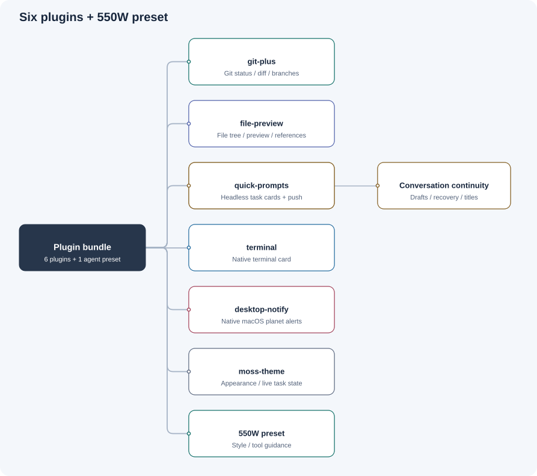
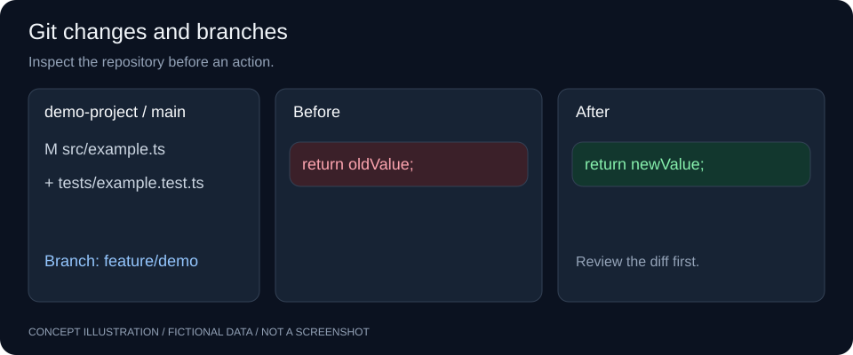
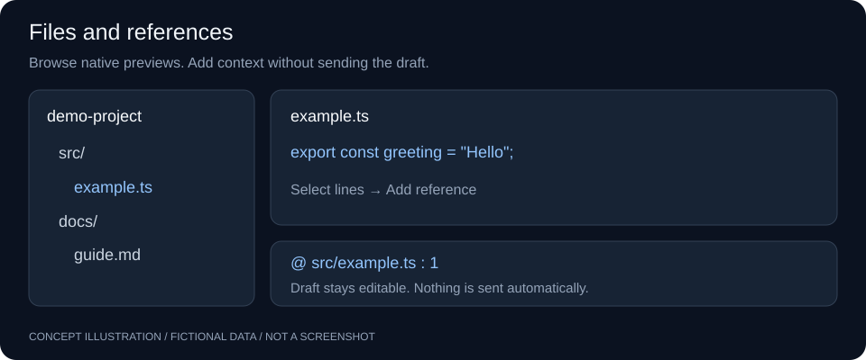
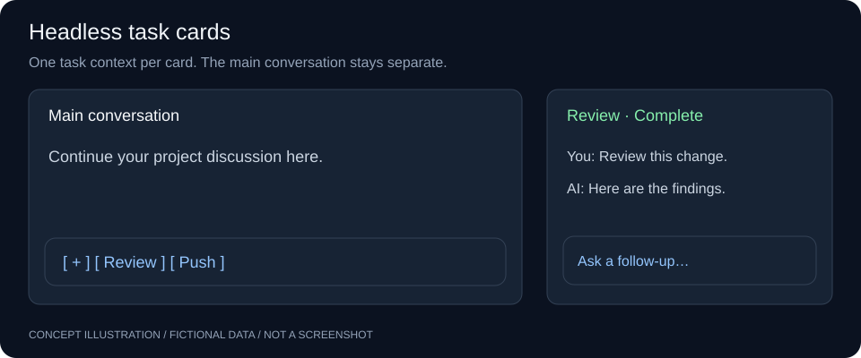
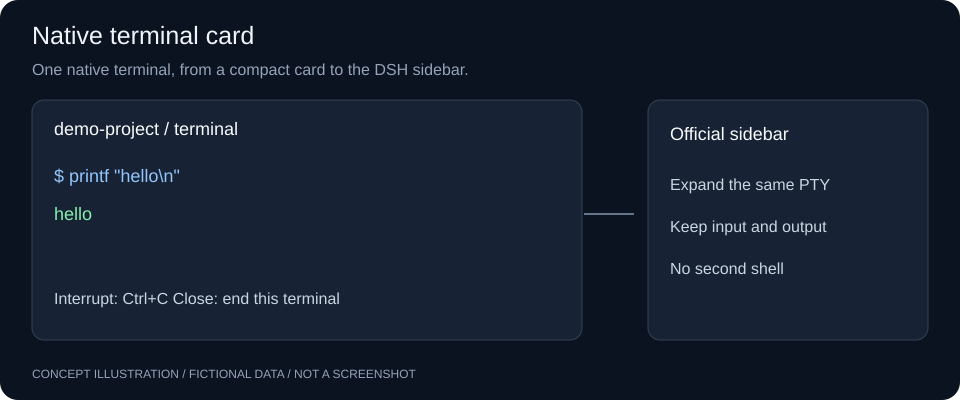
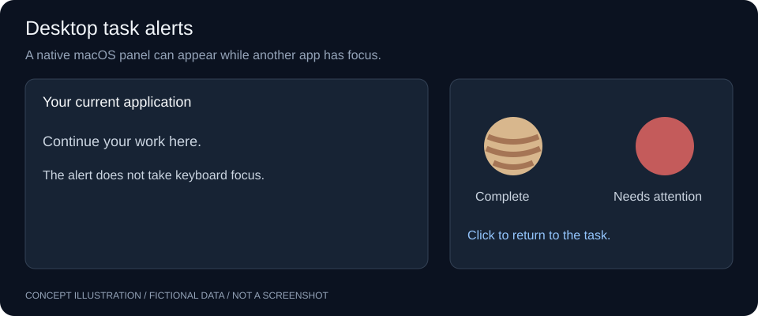
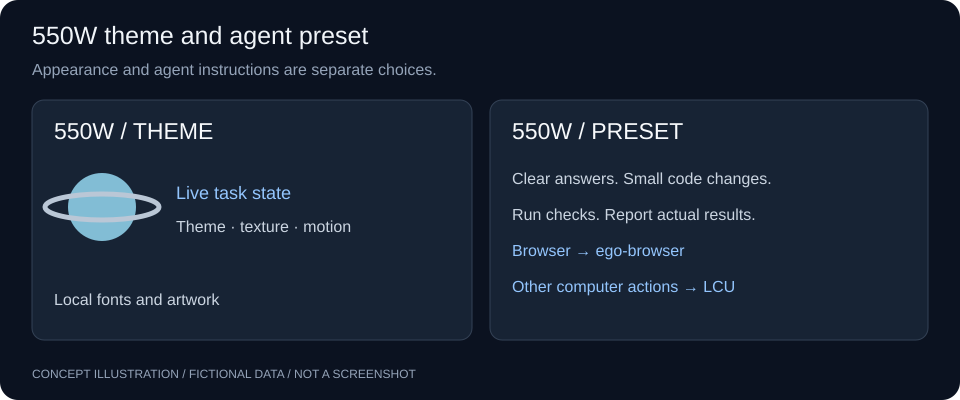

# dsh-forme

**Six plugins and the 550W agent preset for DeepSeek Harness.**

Inspect Git changes, browse files, run small tasks, use a terminal, and receive desktop alerts in one workspace.

[中文使用说明](README.zh-CN.md) · [Plugin directory](plugins/README.md)

> All images below are program-drawn concept illustrations with fictional content. They are not screenshots. They contain no real conversations, accounts, projects, or local machine paths. Layouts explain features, rather than reproduce the exact application UI.



## Included components

| Component | Entry point | Purpose |
| --- | --- | --- |
| [dsh-git-plus](plugins/dsh-git-plus/README.md) | Changes and repository menu | Git status, side-by-side diffs, and branch selection across local repositories. |
| [dsh-file-preview](plugins/dsh-file-preview/README.md) | Files tab | Native file tree and previews; file and code-selection references in drafts. |
| [dsh-quick-prompts](plugins/dsh-quick-prompts/README.md) | Shortcuts above the composer | Headless task cards, follow-up input, project shortcuts, commit-and-push, and main-session helpers. |
| [dsh-terminal](plugins/dsh-terminal/README.md) | Terminal icon in the shortcut bar | Native terminal card that can move to the official sidebar. |
| [dsh-desktop-notify](plugins/dsh-desktop-notify/README.md) | Account menu or General settings | Native macOS planet alerts for completion, errors, approvals, and questions. |
| [dsh-moss-theme](plugins/dsh-moss-theme/README.md) | General settings | 550W colors, fonts, project icons, Earth animation, and live task state. |
| 550W preset | Native Agent preset selector | Clear technical prose, coding rules, and ego / LCU tool guidance. |

The theme and agent preset are separate. The theme does not change a session's identity or system prompt.

## Install

### Recommended: local checkout on official macOS Desktop

Install DeepSeek Harness Desktop, Git, and **Node.js 22.18+ in the 22.x line, or 24.11+**. Native desktop alerts also need Xcode Command Line Tools. The helper compiles on first use.

```sh
git clone https://github.com/percentcola3/dsh-forme.git
cd dsh-forme
npm run install:desktop
```

The installer uses the app's bundled pnpm and CLI. It builds all six plugins and installs the bundle into the Desktop profile.

1. Quit and reopen DSH.
2. Open **Plugins** and check the six plugin components under `dsh-forme`.
3. Select or create a conversation with a working directory.
4. Select **550W** in the native preset selector if you want its agent instructions.

Keep the checkout in place. This is a linked installation. The plugin manager also lists the 550W preset, for seven bundle components in total.

For an app outside the default location:

```sh
DSH_APP_RESOURCES='/path/to/DeepSeek Harness.app/Contents/Resources' npm run install:desktop
```

### From GitHub

Enter this address in DSH's **Add Plugin** dialog:

```text
git+ssh://git@github.com/percentcola3/dsh-forme.git
```

The bundle's Git dependencies require GitHub SSH access. Use HTTPS clone and the local installer above if you do not use SSH. The repository includes built plugin files.

For a Web profile with the `dsh` CLI:

```sh
# Full bundle
dsh plugin --profile web add 'git+ssh://git@github.com/percentcola3/dsh-forme.git'

# One component
dsh plugin --profile web add 'git+ssh://git@github.com/percentcola3/dsh-forme.git#path:plugins/dsh-git-plus'
```

Replace the final package name with any of the six plugins. For terminal cards, install Quick Prompts too: it supplies the entry point. Restart `dsh web` after installation. A bare CLI profile lacks the Web UI services needed by this bundle.

### Update

Save your local changes first, then run:

```sh
git pull --ff-only
npm run install:desktop
```

Quit and reopen DSH after the update.

## 1. Git status, diffs, and branches



- Open **Changes** for file status and side-by-side diffs.
- Inspect insertions, deletions, modifications, and untracked files.
- Use the repository menu for the current directory and nested repositories.
- Work with existing submodules and linked worktrees.
- Search local branches and already-fetched remote tracking branches.
- Select a remote tracking branch to create a same-name local branch with an upstream.

Branch selection affects only the selected repository. Git errors appear without a forced overwrite. Repository discovery and line counts have limits; partial results are marked.

**Start commits and pushes from the shortcut bar's “推送 / Push” action.** Git Plus supplies inspection and branch controls. It does not send commit instructions to the main conversation.

## 2. Files and context references



1. Open **文件 / Files**.
2. Select a file in the left tree to use the native preview.
3. Right-click and choose **将文件插入 Chat** to add a file reference.
4. For code, select lines and choose **将代码插入 Chat**.
5. Add your question and send the draft yourself.

References preserve valid paths and add line context when available. They do not paste the source or send a message automatically. Existing drafts and references stay intact. The header also provides project-path copy access.

## 3. Shortcuts and headless task cards



Click **+** above the composer to save a name and instruction. Click a shortcut to run it. Use the pencil or right-click to edit it. Each shortcut can select a fixed model or follow the main session's model at launch.

- Each task has its own headless Agent and project directory, without copied main-session history.
- Cards show user messages and public AI text, with follow-up input in the same task context.
- Enter sends; Shift+Enter inserts a newline. IME confirmation does not send a message.
- Cards belong to the main session that launched them. They do not enter project or Ungrouped conversation lists.
- Completed, failed, and stopped cards remain available for review and follow-up.
- Close stops that task and releases its runtime resources. Other tasks and the main conversation continue.

Git workspaces get one default **Push** shortcut. It checks scope and target, runs suitable checks, commits relevant changes, then pushes normally. Existing commits can still be pushed if there are no new changes. Failed checks or commits stop the task. It does not force-push. User-edited old shortcuts are preserved.

**Limits:** cards have no extra approval UI. Operations that need additional permission report the limit. Questions use card text and follow-up input. DSH still persists underlying logs; closing a card does not erase them. Cards do not resume after a DSH restart.

Quick Prompts also supplies these main-session helpers:

| Helper | Behavior |
| --- | --- |
| Draft reuse | Reuse an empty session with a draft in the same project. |
| Restart continuation | Conditionally resume an observed ordinary session interrupted by exit or crash, once. Do not restore deliberately stopped, completed, or error-blocked tasks. |
| Automatic titles | Update automatic titles after a completed turn using public conversation text. Keep manual titles. This adds a model call. |

## 4. Native terminal card



Open the terminal icon in the shortcut bar and enter shell commands directly. DSH owns the native terminal, PTY, directory, input, output, and recovery.

- **Interrupt** sends Ctrl+C.
- **Expand** moves the same terminal to the official sidebar without another shell.
- Hiding the card or switching projects does not end the terminal.
- **Close** ends that card's terminal.

The terminal belongs to its original session. Other sessions in the same project can return to that terminal through its entry point.

## 5. Desktop task alerts



Configure **桌面提醒 / Desktop alerts** in the account menu or General settings. A native macOS panel can appear with DSH in the background or minimized. It does not take keyboard focus.

- Normal completion shows a slowly rotating Jupiter.
- Approvals, questions, and errors show a red, faster-moving Jupiter.
- Choose a screen corner or edge midpoint, and the primary or pointer display.
- Set duration, alert categories, and optional sounds.
- Click an alert to return to the session. Concurrent alerts queue.

Dismissal does not answer a question, approve a tool, or cancel a task. Native placement currently supports **macOS 12+**. Other platforms do not provide this native panel.

## 6. 550W theme and preset



The theme includes blue-gray surfaces, local fonts, project icons, an Earth home scene, a task travel strip, and a Saturn state icon. State comes from the current session. Animation does not prove success. Theme, texture, and motion have separate controls and respect reduced-motion preferences.

The **550W preset** uses the standard tool composition with these instructions:

- Use short sentences and consistent terms. Give the result, evidence, and next step.
- Read code first, find the cause, make small changes, and report actual checks.
- For browser operations, use the `ego-browser` skill when available.
- For other computer operations, use LCU Computer Use when available.

ego and LCU must be available separately in the host. This bundle does not install them or bypass permissions.

## Compatibility and troubleshooting

The current primary target is **official macOS Desktop 0.2.1-rc.2**. Some features were also checked on 0.2.0-rc.2. New DSH releases need review; this is not a cross-platform or all-version guarantee.

| Symptom | Check |
| --- | --- |
| Bundle present, components inactive | Use `npm run install:desktop` for a local checkout. A root link alone does not install dependencies. |
| No files or Git status | Select a session with a working directory and a valid Git worktree. |
| macOS Git unavailable | Configure an installed Git executable in the Git plugin. This affects only its own calls. |
| Shortcut cannot run | Read the card error. Check model, main-session state, and permissions. No `spawn` provider is required. |
| No native alerts | Check macOS version, alert settings, and Xcode Command Line Tools. |
| UI changes after a DSH upgrade | Check compatibility and reload the app after an update. |

## Development and illustration sources

```sh
cd plugins
pnpm install --frozen-lockfile --ignore-scripts
pnpm -r run test
pnpm -r exec tsc --noEmit
pnpm -r run build
```

Keep plugin `lib/` outputs synchronized with source changes. Reload the plugin or app after Host changes. Git tests use temporary repositories; do not replace tests with a real commit or push.

Generate the six feature images with `node scripts/generate-readme-art.mjs`. The overview is a static vector diagram. All labels are examples; no screen capture is involved. The historical `desktop/` wrapper is not needed for the official-app installation.

## License

[MIT](plugins/dsh-git-plus/LICENSE). The theme is an unofficial tribute. Independent artwork and font notices are in the [theme NOTICE](plugins/dsh-moss-theme/NOTICE).
