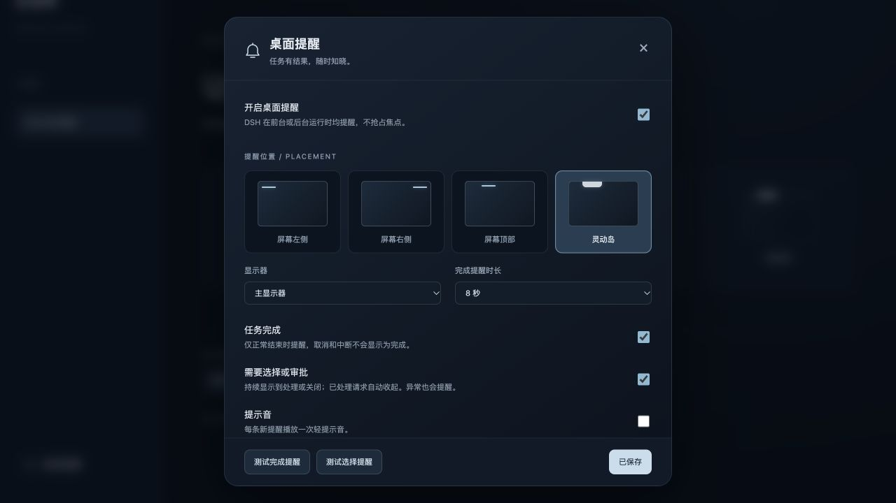
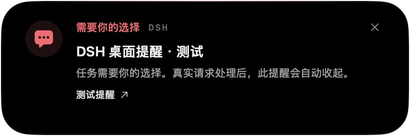

# dsh-desktop-notify

DSH 的独立桌面提醒插件。服务端监听全部普通会话的实时事件，macOS 原生非激活悬浮窗在应用前台、后台、最小化或其他桌面空间时均可显示，不依赖当前选中的任务，也不会抢走键盘焦点。

## 使用

安装整套 `dsh-forme`，或单独添加：

```sh
dsh plugin --profile desktop add 'git+ssh://git@github.com/percentcola3/dsh-forme.git#path:plugins/dsh-desktop-notify'
```

重启 DSH 后，在侧栏底部点击「桌面提醒」，或进入设置的「通用」配置。选择屏幕左侧、右侧、顶部或灵动岛样式，支持主显示器/鼠标所在显示器、4–30 秒显示时长、完成提醒、审批/问题提醒及提示音。点击「保存设置」立即生效，测试按钮也会保存当前设置。

- 正常完成一轮任务时提醒；取消、中断、拒绝和空转不显示为完成。异常单独提示。
- 工具审批与 `ask_user_question` 问题持续显示，直到处理或手动关闭。超时后仍可回答的问题会保留，已回答后自动收起。
- 同时到达的提醒排队，优先显示需要选择的任务；子代理内部事件不单独刷屏。
- 点击「查看任务」唤起已有的 DeepSeek Harness 窗口，由插件打开对应会话。提醒本身不会代答问题或批准操作。
- 悬停暂停自动关闭。灵动岛是在屏幕上方显示的黑色圆角卡片，会避开菜单栏与刘海；无需系统通知授权。






## 平台与生命周期

自定义桌面位置当前支持 **macOS 12 及以上**。首次使用需要本机 Xcode Command Line Tools 的 `swiftc`，原生辅助程序从随包 Swift 源码编译并缓存在 `~/.dsh/cache/desktop-notify/`。不下载可执行文件、不修改 DSH 安装包，也不创建后台登录项。DSH/插件退出后，辅助程序随输入管道关闭退出。其他系统会在配置面板明确显示当前不支持原生定位，不伪装成可跨应用显示的网页提示。

设置保存在 `~/.dsh/desktop-notify.json`；最近提醒仅存进程内存，不额外记录聊天历史。应用退出或机器休眠时不会执行任务；锁屏、屏幕保护程序和 macOS 对全屏窗口的管理仍由系统控制。

## 开发验证

```sh
pnpm typecheck
pnpm test
pnpm build
pnpm exec tsdown --config preview/tsdown.config.ts
node preview/server.mjs
```

访问 `http://127.0.0.1:4180/`。预览使用隔离设置和模拟会话，调用同一生产事件监听器与原生辅助程序，可测试完成、等待选择、回答和取消，不向真实任务发送消息。
