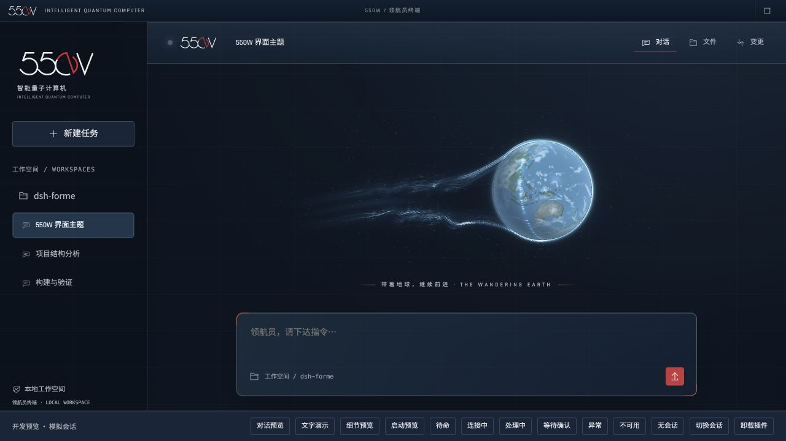
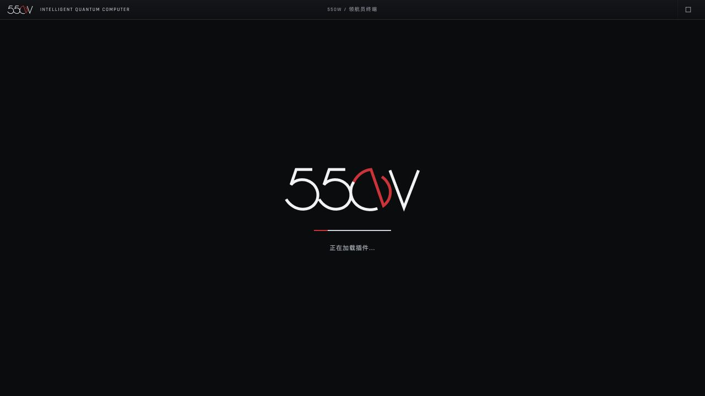

# 550W 流浪地球主题

《流浪地球》与 550W 风格的 DSH Web UI 主题插件。界面采用深蓝灰面板、灰白仪表文字，柔红文字用于新建会话、选中任务、激活标签、通讯标记和编号等强调，正文保持灰白。首页与对话中的航行条共用一个全场景 WebGL 着色器：浅冰蓝地球（本地内嵌 NASA 地表/云层纹理，提亮海洋与暗面）、地表一圈行星发动机光带，以及大气层在推进中被剥离、沿球面绕流后向后收束、汇成细尾的动态尾流，配闪烁星空。发动机推力跟随真实会话状态平滑变化；运行时无远程图片、字体或遥测请求。

## 安装

仓库根安装包已包含该插件，本地安装：

```sh
npm run install:desktop
```

退出并重新打开 DSH，在「插件」中确认 `dsh-moss-theme` 运行。也可单独安装本地目录（先完成下方构建）：

```sh
dsh plugin --profile desktop add --ignore-scripts /absolute/path/to/dsh-forme/plugins/dsh-moss-theme
```

源码发布到 GitHub 后可使用：

```sh
dsh plugin --profile web add 'git+ssh://git@github.com/percentcola3/dsh-forme.git#path:plugins/dsh-moss-theme'
```

包名 `dsh-moss-theme`、预设 ID `moss` 和设置存储键沿用旧值，以兼容现有安装；界面、预设显示名称和启动标识统一为 **550W**。

## 550W 智能体

本包除了主题，还声明一个名为 **550W** 的 agent preset（`cordis.patch.yml` 中的 `preset-moss`）：工具组合与 DSH 自带的 `standard` 完全相同，只把人设换成 550W：冷静、结论先行，称呼你为「领航员」，区分事实/推测/未知，不编造数据，遵守审批和安全边界。它是真正的会话身份，不是复制粘贴的提示词。

- 接入：在 DSH 自带的预设选择器里选择「550W」，或在 设置 → Agent 预设 中把它设为默认。主题不再提供独立控制台与接入按钮。
- 状态指示只读取实际任务状态；是否使用 550W 人设由 DSH 原生 Agent 预设决定，主题不会自动切换会话身份。
- 人设使用 `@deepseek-ai/dsh-persona` 的前缀模式（非 `complete`），DSH 的工具说明、安全与审批指引保持不变。人设明确说明这是致敬，模型没有超出工具的能力。
- 预设列表基于 DSH 0.2.1-rc.2 的 `standard` 预设复制而来；DSH 升级其标准预设后需同步。
- 「对话风格指令」仍保留，供不想切换预设的会话使用。

## 550W 交互语言

- **550W 字标**：侧栏与启动页共用本地手绘 SVG，保留电影标识的连续细线和红白交叠设计。主界面仅在侧栏居中保留字标，新建会话按钮的图标和文字也共同居中，对话顶部仅显示被动呼吸灯；对话标题从顶部隐藏，侧栏仍可查看会话名称。
- **启动动画**：宿主加载插件前即可显示 550W，使用轻微显现和红白呼吸进度线；真实加载提示和错误信息继续显示。主题关闭或减少动态效果时遵循相应设置。
- **窗口拖动**：复用宿主现有对话头部和侧栏头部的空白区域，不添加独立顶栏。Electron 使用原生拖动及双击最大化/还原，Tauri 调用窗口桥接接口。按钮、标签页、菜单及输入控件排除在拖动区外。macOS 保留系统窗口按钮安全区。环境纹理层不再覆盖宿主的原生拖动区域。
- **深蓝灰终端**：聊天区、侧栏与输入框使用不同深浅的深蓝灰，配低对比仪表网格和灰白文字。首页仅保留地球与主题标语，移除三处场景标签和宿主标题/预览版标记。
- **地球自转**：任务航行条约 18 秒一圈，首页约 40 秒。地表和云层围绕倾斜轴连续旋转，自转与尾流使用独立时钟，状态切换不重置角度；关闭动效或减少动态效果时一起暂停。
- **状态灯**：头部仅保留一个简洁的柔光 LED，不带镜头、字标或弹出面板。悬停提示和无障碍名称提供具体状态，状态来自当前选中会话的宿主数据。
- **交互细节**：对话区有边缘反光与淡舱壁纹理；用户消息增加细边和右上角标。侧栏与选项的选中态使用完整的蓝灰底块和均匀细边，不再显示左侧半括号；键盘焦点保留独立细框。正文选择为半透明蓝色，代码选择为银灰色，输入光标为灰白色。输入框左上、右下角标使用信号红。
- **仪表图标**：AI 回复标识加入本地自绘轨道图形。原生操作图标保留功能形状，统一悬停与焦点高亮。代码块标题、时间与数字使用仪表字体，正文与代码保持各自的字体层级。

## 字体

侧栏、会话列表、菜单、按钮、普通标签与输入框的英数统一使用内嵌的 **Rajdhani Medium / SemiBold**，中文回退到 **Noto Sans SC Regular / SemiBold**（与思源黑体同源）。对话正文使用 Noto Sans SC，代码使用等宽字体，保持长篇阅读与代码对齐。550W 字标是独立 SVG，不依赖字体。这是电影界面风格的字体搭配，不将正文字体宣称为电影的原版字体。字体随客户端打包，支持离线；SIL OFL 授权保存在 `licenses/`，来源见 `NOTICE`。

## 使用

- AI 回复采用通讯终端排版：细线侧轨、`AI TRANSMISSION` 标识、二级标题编号、灰白列表标记。Markdown 的 `>` 引用保留原文，显示为带 `QUOTE / 引文` 标识和红色细边的半透明信息框。排版只作用于 AI 正文，用户消息、思考折叠区和文档预览保持各自布局。
- 文字动效跟随 DSH 的 `data-streaming` 标记：开始输出时短暂显现，末端有轻微扫描提示；流式输出结束后恢复静态。正文不进行乱字符替换，不增加逐字等待，也不改写复制内容。「界面动效」与系统减少动态效果设置均可停止动画。开发预览中的「文字演示」可重复观看本地模拟输出。
- 新会话首页：浅蓝地球向右航行，连续的半透明大气层从上下球缘绕出，向后弯曲收拢成蝌蚪状细尾，细丝沿共同尾轴流动；配「带着地球，继续前进」。待命时尾流也清晰可见，处理中进一步增强。
- 处理任务时，对话流末尾 DSH 自带的「深度求索中，用时 xx 秒」行被替换为航行条：左侧地球向左航行、尾流向右延伸，右侧显示任务时钟 `T+mm:ss`。繁星、地球与尾流以透明背景直接融入对话，不使用黑底、描边或面板圆角，边缘渐隐。时钟直接读取 DSH 自身的计时文字，不另行计时；DSH 的读屏状态播报保留。只通过稳定属性 `data-chat-running` 定位，关闭主题或停用插件后恢复原样。输入框上方不再显示加载条。
- 发动机推力是会话状态的视觉映射，并非遥测：待命 38%、连接 62%、处理中 100%、等待确认 22%、异常 12%、不可用 0%，状态切换时约 1 秒平滑升降。
- 在 **设置 → 通用设置 → 550W / 流浪地球** 中调整主题、环境纹理与动效。头部呼吸灯只用于显示任务状态，不会弹出面板。
- 550W 状态灯：空闲为银灰慢呼吸（4.8 秒）；建立连接为冷白快呼吸（1 秒）；执行任务为冰蓝呼吸（1.6 秒）；等待审批或回答为柔红慢呼吸（3.2 秒）；异常为警示红双脉冲（每 2.8 秒一组）；会话不可用为灰色静止暗灯。不将任务停止误报为成功。关闭动效或系统减少动态效果时保留静态颜色、悬停说明与读屏状态。
- 「流浪地球主题」关闭后恢复 DSH 自身的配色，仍可从通用设置重新启用。在插件管理中停用则移除所有样式、控件、监听器与会话引用。
- 「环境纹理」「界面动效」可独立关闭；关闭动效会冻结场景与状态灯动画，并停止文字扫描。渲染最高约 30 帧/秒，单画布像素上限约 140 万，窗口隐藏或场景离开可视区时暂停，卸载时释放 GPU 资源；无 WebGL 时显示纯 CSS 的简化场景。设置按浏览器持久化并同步同源标签页。系统减少动态效果设置优先。
- 状态直接订阅当前选中的 DSH 会话；切换任务会释放旧引用。显示待命、建立连接、处理中、等待确认、需要检查和会话不可用。等待确认来自 `uiSession.sessionStatus.pendingInteraction`，涵盖宿主的审批与问题请求；任务结束或停止后返回待命，不把停止误报为成功。状态不代表模型能力、任务成功或审批结果；错误详情仍在原对话查看。
- 仅安装主题不会发送聊天内容或改变系统提示词；550W 人设由原生 Agent 预设选择器单独启用。不包含语音合成和自动语音播放。

## 开发与验证

需要 Node 22.18+（22.x）或 24.11+ 及 pnpm。从仓库根目录：

```sh
pnpm --dir plugins install --frozen-lockfile --ignore-scripts
pnpm --dir plugins/dsh-moss-theme build
pnpm --dir plugins/dsh-moss-theme typecheck
pnpm --dir plugins/dsh-moss-theme test
pnpm --dir plugins/dsh-moss-theme preview:build
python3 -m http.server 4178 --bind 127.0.0.1 --directory .build/moss-preview
```

打开 <http://127.0.0.1:4178/> 查看真实插件组件在模拟 DSH 宿主中的预览；底部按钮模拟状态、切换会话及卸载。预览中的任务文本仅为界面示例，不执行模型请求。`preview/` 不进入插件发布包。

「细节预览」展示字体、六种仪表图标、图标选中态与输入焦点；点击「选中引文」查看正文的选择高亮。该展示区只存在于开发预览中。已验证 390px 窄屏、环境纹理/主题关闭后的恢复，以及本机桌面端侧栏选中和对话样式。

基于本机 DSH 的 `conversation.header.leading`、`settings.general.item` 插槽、`uiWorkspace.selection` 和 `sessions.retain` 接口实现；主题通过语义颜色变量作用于原生面板和弹层，不依赖构建后的 CSS 类名。已在 macOS DSH **0.2.1-rc.2** 验证居中字标、新建会话排版、红色选中状态、无控制台的状态灯，以及通用设置中开关主题。完成构建、类型检查和 17 项自动化测试，覆盖状态、设置、清理、窗口行为和启动兼容性。后续 DSH 版本仍需验收。发布时提交 `lib/` 构建产物，使安装不依赖 prepare 脚本。

代码为 MIT。地表和云层素材来自 NASA Blue Marble，来源与署名见 [NOTICE](NOTICE)。非官方致敬主题。

## 界面

550W 字标与地球首页（早期模拟宿主，图中独立顶栏已移除）：



启动预览（与宿主启动页共用字标和动画）：



已在本机 macOS 官方桌面端确认冷启动时显示 550W、侧栏标识完整，以及顶部拖动与原生窗口缩放/最小化操作。Tauri 外壳源码和构建权限同步更新，本轮未重新打包该历史外壳。开发预览提供「启动预览」「文字演示」「细节预览」和模拟状态切换。
